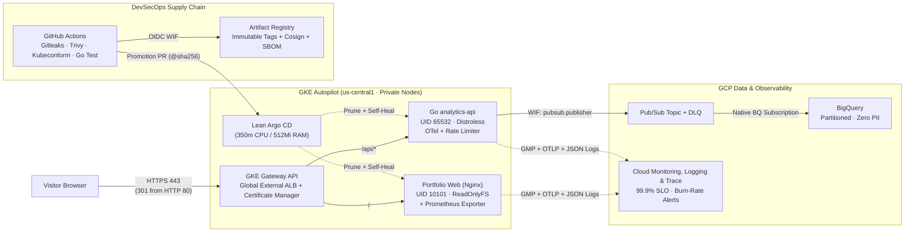

# PortfolioOps — bikramsarkar.space on GKE

A production-grade Platform Engineering & SRE reference implementation hosting [bikramsarkar.space](https://bikramsarkar.space) on **Google Kubernetes Engine (GKE Autopilot, `us-central1`)** with GitOps, Helm, OpenTelemetry, supply-chain security, SLO-driven alerting, and privacy-first visitor analytics.

## System Architecture



## Engineering Documentation

| Artifact | Purpose |
| --- | --- |
| [ADR-001](docs/adrs/0001-platform-architecture-and-monorepo.md) | Architecture decisions, Autopilot cost guardrails (`~$38–$57/mo` lean), and monorepo GitOps boundaries |
| [Threat Model](docs/threat-model.md) | Trust boundaries and STRIDE analysis mapped to implemented controls |
| [SLO Policy](docs/slo-policy.md) | `99.9%` rolling 30-day availability SLO (`43.2m` budget), multi-window burn-rate alerts, DORA metrics |
| [Incident Runbooks](docs/runbooks/) | Alert-linked runbooks: [Site Unavailable](docs/runbooks/site-unavailable.md), [SLO Burn](docs/runbooks/slo-error-budget-burn.md), [CrashLoop & Rollback](docs/runbooks/pod-crashloop-and-rollback.md), [5xx & Gateway](docs/runbooks/http-5xx-and-gateway.md) |
| [Chaos & Recovery Drills](docs/drills/chaos-and-recovery-drills.md) | Drift self-healing, zero-downtime pod eviction, GitOps rollback, Cosign verification, and DR rebuild |
| [BigQuery Queries](docs/analytics-queries.sql) | Partition-pruned visitor summary, referral domains, device split, and hourly anomaly detection |

## Repository Layout

```text
bikramsarkar-portfolio/
├── index.html, 404.html, profile.png, assets/   # Static portfolio (root keeps GitHub Pages live until DNS cutover)
├── services/analytics-api/                      # Go + OpenTelemetry privacy-first visitor analytics microservice
├── deploy/
│   ├── docker/                                  # Hardened non-root Nginx Dockerfile & JSON logging / CSP configs
│   ├── charts/portfolio/                        # Helm v2 chart (Gateway API, HealthCheckPolicy, PDB, NetPol, GMP)
│   ├── charts/analytics-api/                    # Helm v2 chart (distroless Go API, WIF SA, HealthCheckPolicy, NetPol)
│   └── gitops/                                  # Lean Argo CD bootstrap, scoped AppProject & App-of-Apps prod values
├── infra/terraform/
│   ├── bootstrap/                               # One-time versioned GCS state bucket script
│   ├── modules/                                 # networking, gke-autopilot, artifact-registry, cert-manager, wif, budget, observability, analytics-pipeline
│   └── environments/prod/                       # Production us-central1 wiring + multi-platform provider lock
├── .github/                                     # Path-filtered ci.yaml, release.yaml, terraform-plan.yaml, dependabot.yml
└── docs/                                        # ADRs, Threat Model, SLO Policy, Runbooks, Drills, BigQuery SQL
```

## Implementation Roadmap

- [x] **Phase 1 — Foundation**: Hardened non-root Nginx container (`UID 10101`), production Helm chart (GKE Gateway API, HTTP→HTTPS redirect, `HealthCheckPolicy`, PDB, `NetworkPolicy`), ADR-001, and local Helm/Trivy validation.
- [x] **Phase 2 — IaC & GitOps**: Modular Terraform (`us-central1` VPC + Cloud NAT, private GKE Autopilot with least-privilege node SA, Artifact Registry, Certificate Manager, GitHub WIF, Billing Budget) + lean Argo CD App-of-Apps with multi-source Helm promotion.
- [x] **Phase 3 — DevSecOps**: Path-filtered GitHub Actions (`ci.yaml`, `release.yaml`, `terraform-plan.yaml`), Gitleaks, Trivy, Kubeconform, Syft SPDX SBOM, Cosign keyless signing/attestation, automated GitOps digest promotion PRs, and Dependabot.
- [x] **Phase 4 — Observability & SRE**: Terraform-managed Cloud Monitoring HTTPS uptime checks, `99.9%` rolling 30-day availability SLO, multi-window fast/slow burn-rate alerts, SRE dashboard, Nginx Prometheus exporter + filtered GMP `PodMonitoring`, SLO policy, and alert-linked runbooks.
- [x] **Phase 5 — Visitor Analytics**: Same-origin privacy-first Go `/api/v1/events` service (OpenTelemetry OTLP traces/metrics, daily-salted session hashing, bot filter, per-IP rate limiting, distroless image) → Pub/Sub native BigQuery subscription + DLQ + Workload Identity IAM + Argo CD GitOps app.
- [x] **Phase 6 — Staff-Level Evidence**: STRIDE threat model, operational chaos/drift/rollback drills, partition-pruned BigQuery analytics SQL, and end-to-end architecture documentation.

## Local Build & Verification

### 1. Static Portfolio Container (mirrors GKE `readOnlyRootFilesystem`)

```bash
docker build -f deploy/docker/Dockerfile -t portfolio:local .

docker run --rm -d --name portfolio-test \
  --read-only \
  --cap-drop=ALL \
  --tmpfs /tmp:rw,noexec,nosuid,size=16m \
  --tmpfs /var/cache/nginx:rw,noexec,nosuid,size=16m \
  -p 8080:8080 \
  portfolio:local

curl -i http://localhost:8080/healthz
curl -I http://localhost:8080/
curl -I http://localhost:8080/profile.png
curl -i http://localhost:8080/does-not-exist
docker stop portfolio-test
```

### 2. Go Analytics API Tests & Local Run

```bash
cd services/analytics-api
go vet ./...
go test -v ./...
go run ./cmd/server
```

### 3. Helm, Terraform & Trivy Security Validation

```bash
helm lint deploy/charts/portfolio -f deploy/gitops/envs/prod/values-portfolio.yaml
helm lint deploy/charts/analytics-api -f deploy/gitops/envs/prod/values-analytics-api.yaml

terraform fmt -check -recursive infra/terraform
terraform -chdir=infra/terraform/environments/prod init -backend=false
terraform -chdir=infra/terraform/environments/prod validate

trivy config --exit-code 1 deploy
trivy config --exit-code 1 services/analytics-api
trivy config --exit-code 1 infra/terraform
```

## GCP Deployment Quickstart (`us-central1`)

1. **Bootstrap remote Terraform state & apply infrastructure**:
   ```bash
   ./infra/terraform/bootstrap/state-bucket.sh <YOUR_GCP_PROJECT_ID> us-central1
   cd infra/terraform/environments/prod
   cp terraform.tfvars.example terraform.tfvars
   # Fill in project_id, workstation CIDR, optional billing_account_id, and alert_email
   terraform init -backend-config="bucket=<YOUR_GCP_PROJECT_ID>-tfstate-portfolio-ops"
   terraform apply
   ```
2. **Configure DNS validation & GitHub Repository Variables**:
   - Add `terraform output dns_authorization_cname` at your DNS registrar so Certificate Manager issues the TLS certificate.
   - Set GitHub Actions Repository Variables (`GCP_PROJECT_ID`, `GCP_WIF_PROVIDER`, `GCP_CI_SERVICE_ACCOUNT`, `GAR_LOCATION`, `GAR_REPOSITORY`) and enable **Allow GitHub Actions to create and approve pull requests**.
   - Update `PROJECT_ID` placeholders in `deploy/gitops/envs/prod/values-portfolio.yaml` and `values-analytics-api.yaml`.
3. **Bootstrap lean Argo CD & cut over DNS**:
   ```bash
   # Authenticate kubectl via `terraform output -raw kubectl_credentials_command`
   ./deploy/gitops/bootstrap/install.sh
   ```
   Once `portfolio-gateway` is `PROGRAMMED` and `portfolio-cert` is `ACTIVE`, point `bikramsarkar.space` `A` record to `terraform output -raw gateway_static_ip`.
