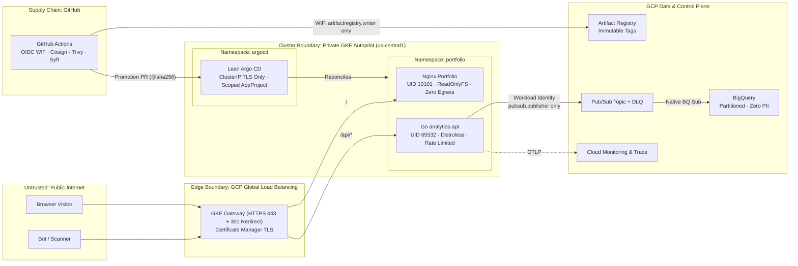

# PortfolioOps — Threat Model & Trust Boundaries

## 1. System Trust Boundaries

## 2. STRIDE Threat Analysis

| Category | Threat Scenario | Implemented Control | Location | Residual Risk / Next Hardening |
| --- | --- | --- | --- | --- |
| **Spoofing** | Forged GitHub CI token pushes malicious image to Artifact Registry | Workload Identity Federation restricted by OIDC `attribute_condition` to `sarkarbikram90/bikramsarkar-portfolio` on `refs/heads/main`; zero static keys | [workload-identity-github/main.tf](../infra/terraform/modules/workload-identity-github/main.tf) | Enforce GitHub branch protection + required reviewer on `main` |
| **Tampering** | Compromised container image deployed to GKE | Immutable tags in Artifact Registry, `@sha256` digest pinning in GitOps values, Cosign keyless OIDC signing + SPDX SBOM attestation, **GKE Binary Authorization (`ENFORCED_BLOCK_AND_AUDIT_LOG`)** backed by Cloud KMS asymmetric attestor, and **40-char SHA-pinned GitHub Actions** | [release.yaml](../.github/workflows/release.yaml), [binary-authorization/main.tf](../infra/terraform/modules/binary-authorization/main.tf), [artifact-registry/main.tf](../infra/terraform/modules/artifact-registry/main.tf) | Periodically rotate KMS signing key version and audit the 4-entry infrastructure image allowlist |
| **Tampering** | Unauthorized manual cluster mutation (`kubectl edit`) | Argo CD `selfHeal: true` + `prune: true`; CI publisher SA has **zero** GKE IAM permissions; `master_authorized_networks_config` restricts API server access | [portfolio-app.yaml](../deploy/gitops/envs/prod/apps/portfolio-app.yaml), [gke-autopilot/main.tf](../infra/terraform/modules/gke-autopilot/main.tf) | Add GCP Audit Log alert on direct `kubectl` write verbs in `portfolio` namespace |
| **Repudiation** | Inability to trace who deployed a change or what code is running | Every production change is a signed Git commit / promotion PR; OCI revision labels + Sigstore Rekor transparency log; Cloud Logging JSON access logs | [release.yaml](../.github/workflows/release.yaml), [nginx.conf](../deploy/docker/nginx/nginx.conf) | Retain Cloud Audit Logs in a dedicated log bucket if compliance retention > 30d is needed |
| **Information Disclosure** | Leaked secrets in Git, Terraform state, Cloud Run specs, or PII stored in analytics | Gitleaks full-history CI gate; digest webhook stored in **Google Secret Manager** (`secret_key_ref` with least-privilege `secretAccessor`, never in `tfvars`/state/specs); daily-rotating in-memory HMAC salt (`SessionID`); raw IPs never logged or stored; referrer query strings stripped | [ci.yaml](../.github/workflows/ci.yaml), [digest-scheduler/main.tf](../infra/terraform/modules/digest-scheduler/main.tf), [privacy.go](../services/analytics-api/internal/privacy/privacy.go) | Periodically audit BigQuery schema before adding new event fields |
| **Information Disclosure** | Public exposure of Argo CD admin UI or Nginx metrics | Argo CD served over TLS on internal `ClusterIP` only (accessed via `kubectl port-forward`); Nginx `/stub_status` bound to `127.0.0.1:8081`; port `9113` `NetworkPolicy` restricted strictly to `gmp-system` | [values-lean.yaml](../deploy/gitops/bootstrap/argocd/values-lean.yaml), [networkpolicy.yaml](../deploy/charts/portfolio/templates/networkpolicy.yaml) | Add SSO (OIDC) if multiple operators ever manage the cluster |
| **Denial of Service** | Spam / payload flood against public `POST /api/v1/events` | `http.MaxBytesReader` (`2 KiB`), strict JSON field allowlist, bot UA filter, bounded per-IP token-bucket rate limiter, GCP billing budget (`50%`/`80%`/`100%`) | [handler.go](../services/analytics-api/internal/handler/handler.go), [limiter.go](../services/analytics-api/internal/ratelimit/limiter.go), [billing-budget/main.tf](../infra/terraform/modules/billing-budget/main.tf) | Attach Cloud Armor Standard edge rate-limiting policy if traffic grows beyond personal portfolio scale |
| **Elevation of Privilege** | Container escape or lateral movement from compromised pod | Non-root UIDs `> 10000` (`10101` Nginx, `65532` distroless Go), `readOnlyRootFilesystem: true`, `allowPrivilegeEscalation: false`, `capabilities.drop: [ALL]`, `seccompProfile: RuntimeDefault`, `automountServiceAccountToken: false`, dedicated least-privilege GKE node SA, default-deny egress on Nginx, scoped Argo CD `AppProject` | [Dockerfile](../deploy/docker/Dockerfile), [services/analytics-api/Dockerfile](../services/analytics-api/Dockerfile), [project-portfolio.yaml](../deploy/gitops/bootstrap/argocd/project-portfolio.yaml) | Enable GKE Autopilot Binary Authorization admission enforcement |
